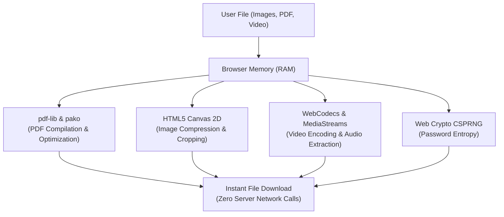

# iLoveTools — 100% Private In-Browser File Utilities 🛠️

[](https://www.ilovetools.org)
[](https://nextjs.org)
[](https://www.typescriptlang.org)
[](https://tailwindcss.com)
[](https://www.ilovetools.org)
[](LICENSE)

> **[iLoveTools (https://www.ilovetools.org)](https://www.ilovetools.org)** is a fast, 100% private web utility suite with 28+ tools running locally inside your browser memory. **Zero server file uploads, no accounts, no subscriptions, and no daily task limits.**

---

## 🌟 Why iLoveTools?

Most online file converters (Smallpdf, iLovePDF, CloudConvert) force you to upload confidential tax forms, contracts, and private photos to remote cloud servers. To make matters worse, they hit you with paywalls and daily usage limits after just two files.

**iLoveTools eliminates cloud file storage entirely.** Every single operation executes client-side using WebAssembly, HTML5 Canvas 2D, and modern Web APIs.

* **🔒 100% Client-Side Privacy:** Your files never leave your device RAM or travel across the network. If you disconnect your internet after loading the page, the tools still work!
* **⚡ Zero Artificial Size Limits:** Process files limited only by your local device hardware.
* **🚫 Zero Paywalls or Accounts:** No subscriptions, no credit cards, no sign-ups. Free forever.
* **🚀 Anycast Edge Speed:** Pre-rendered on global edge CDN with sub-90ms response times.

---

## 🧰 Available Tools Directory

All tools are accessible online at **[ilovetools.org](https://www.ilovetools.org)**:

### 📄 PDF Utilities
* **[Merge PDF](https://www.ilovetools.org/merge-pdf):** Combine multiple PDF documents into a single organized file.
* **[Split PDF](https://www.ilovetools.org/split-pdf):** Extract specific page ranges or split documents cleanly.
* **[Compress PDF](https://www.ilovetools.org/compress-pdf):** Losslessly shrink PDF file size using local flate stream optimization.
* **[Rotate PDF](https://www.ilovetools.org/rotate-pdf):** Permanently rotate individual or all pages (90°, 180°, 270°).
* **[Watermark PDF](https://www.ilovetools.org/watermark-pdf):** Add custom text or stamp security watermarks.
* **[Add Page Numbers](https://www.ilovetools.org/add-page-numbers-to-pdf):** Number PDF pages with customizable positioning.
* **[Image to PDF](https://www.ilovetools.org/image-to-pdf):** Convert JPG, PNG, and WebP photos into printable A4 PDFs.
* **[PDF to Excel](https://www.ilovetools.org/pdf-to-excel):** Extract tabular data into editable `.xlsx` spreadsheets.
* **[PDF to Word](https://www.ilovetools.org/pdf-to-word):** Convert document pages into formatted `.docx` files.
* **[PDF to PowerPoint](https://www.ilovetools.org/pdf-to-powerpoint):** Export presentation slides into `.pptx` decks.
* **[PDF to JPG](https://www.ilovetools.org/pdf-to-jpg):** Render PDF pages into high-resolution image files.

### 🖼️ Image & Media Tools
* **[Compress Image](https://www.ilovetools.org/compress-image):** Intelligently shrink JPG, PNG, and WebP files.
* **[Compress Image to 50KB](https://www.ilovetools.org/compress-image-to-50kb):** Precise target compression for government and job portal uploads.
* **[Compress Image to 100KB](https://www.ilovetools.org/compress-image-to-100kb):** Strict 100KB cap optimization with preserved visual clarity.
* **[Resize Image](https://www.ilovetools.org/resize-image):** Exact dimension and percentage aspect-ratio scaling.
* **[Crop Photo](https://www.ilovetools.org/crop-photo):** Interactive aspect-ratio cropping (1:1, 16:9, 4:3, circular).
* **[PNG to JPG](https://www.ilovetools.org/png-to-jpg):** Convert transparent PNGs with custom background fills.
* **[JPG to PNG](https://www.ilovetools.org/jpg-to-png):** Transcode compressed JPGs into lossless PNGs.
* **[HEIC to JPG](https://www.ilovetools.org/heic-to-jpg):** Convert iPhone HEIC/HEIF photos directly in the browser.

### 🎥 Video & Audio Processing
* **[Compress Video](https://www.ilovetools.org/compress-video):** Shrink MP4 and WebM videos for Discord (10MB) and email limits.
* **[Crop Video](https://www.ilovetools.org/crop-video):** Crop video frames for 9:16 Shorts/Reels or 1:1 squares.
* **[Mute Video](https://www.ilovetools.org/mute-video):** Strip noisy audio tracks completely client-side.
* **[Video to MP3](https://www.ilovetools.org/video-to-mp3):** Extract high-quality audio streams without uploading footage.
* **[Video to GIF](https://www.ilovetools.org/video-to-gif):** Generate animated loop GIFs from video clips.

### ⚡ Developer & Productivity Utilities
* **[Password Generator](https://www.ilovetools.org/password-generator):** CSPRNG cryptographic password entropy generator.
* **[QR Code Generator](https://www.ilovetools.org/qr-code-generator):** Create static vector QR codes for URLs, Wi-Fi, and text.
* **[Word Counter](https://www.ilovetools.org/word-counter):** Real-time word, character, sentence, and reading-time analyzer.
* **[Case Converter](https://www.ilovetools.org/case-converter):** Transform text (UPPERCASE, lowercase, Title Case, camelCase).

---

## 🏗️ Technical Architecture



* **Frontend:** Next.js 16 (App Router) + React 19 + TypeScript.
* **Styling:** Tailwind CSS with responsive grid modes (1-column, 2-column, 3-column) and Dark Mode.
* **PDF Engine:** [`pdf-lib`](https://github.com/Hopding/pdf-lib) + [`pako`](https://github.com/nodeca/pako).
* **Icons:** [`lucide-react`](https://lucide.dev).
* **Edge Hosting:** Vercel Anycast Edge Network.

---

## 💻 Local Development

Clone the repository and run the local development server:

```bash
# 1. Clone the repository
git clone https://github.com/<your-username>/ilovetools.git
cd ilovetools

# 2. Install dependencies
npm install

# 3. Start development server
npm run dev
```

Open [http://localhost:3000](http://localhost:3000) in your browser.

To build the production bundle:
```bash
npm run build
npm run start
```

---

## 🧩 Chrome Extension (Manifest V3)

iLoveTools also includes an official Google Chrome Extension allowing 1-click access to all 28 utilities from your browser toolbar:

* Located in the `/extension` directory.
* Built on Chrome's modern **Manifest V3** standard.
* Includes context menu shortcuts (e.g. right-click any image to compress).

To load it locally:
1. Open Chrome and go to `chrome://extensions`.
2. Enable **Developer mode** (top-right).
3. Click **Load unpacked** and select the `/extension` directory.

---

## 📄 License

This project is licensed under the [MIT License](LICENSE).

---

<p align="center">
  <b>Built with privacy in mind by <a href="https://www.ilovetools.org">iLoveTools</a></b>
</p>
